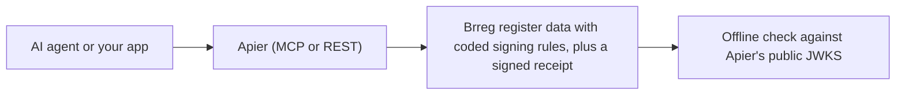

# Apier MCP server: Norwegian company verification and signing authority for AI agents

[](https://github.com/apier-no/apier-mcp/actions/workflows/ci.yml)
[](https://www.npmjs.com/package/@apier-no/mcp)
[](./LICENSE)

[Apier](https://apier.no) gives AI agents machine-verifiable Norwegian company authority. For a 9-digit organisasjonsnummer it returns company verification (registration status, bankruptcy and liquidation flags, VAT registration, registered roles such as daglig leder and the board) and the company's signing authority, signaturrett and prokura, as Brønnøysundregistrene (Brreg) hold it in Enhetsregisteret and Fullmakttjenesten. Each answer carries its source and retrieval time, and you can ask for a signed receipt. It is used in KYB flows where an agent onboards, pays or contracts with a Norwegian company.

Apier runs a hosted [MCP](https://modelcontextprotocol.io) (Model Context Protocol) server at `https://www.apier.no/api/mcp`, listed as `no.apier/mcp` in the official MCP registry. This repository is `@apier-no/mcp`, the npm proxy that connects stdio-only MCP clients to that hosted server. No tool logic runs locally.

## Try it in 30 seconds (no key)

The public sandbox answers for the test company `999999999` without a key or an account:

```bash
curl -s https://www.apier.no/api/v1/sandbox/public/company/999999999/authority
```

Response from 2026-11-25, trimmed (other fields omitted):

```json
{
  "success": true,
  "data": {
    "org_number": "999999999",
    "name": "Apier Public Sandbox AS",
    "entity_type": "AS",
    "classification": "sole",
    "summary": "Én rolle kan signere alene for selskapet.",
    "combinations": [
      {
        "kombinasjons_id": "SANDBOX-KOMB-DAGL-ALENE",
        "description": "Daglig leder signerer alene.",
        "role_codes": ["DAGL"]
      }
    ],
    "signaturrett_holders": [{ "role": "DAGL", "name": "Ola Nordmann" }],
    "prokura_holders": [],
    "source": "brreg.fullmakt",
    "rule_set": "no.brreg.signatur.v1"
  },
  "_meta": { "is_sandbox": true, "source": "apier.no" }
}
```

Sandbox data is fictional. The public sandbox allows 100 requests per hour per IP address. More fixture companies are available with a self-invented bearer; see [Sandbox with a self-invented bearer](#sandbox-with-a-self-invented-bearer).

## How it fits together



Production receipts are detached JWS signatures that verify against `https://www.apier.no/.well-known/jwks.json`. The guide is at https://www.apier.no/docs/guides/verify-certificate.

## Tools

The hosted server publishes its tool list, with each tool's full description and `required_scope`, at the keyless discovery endpoint `GET https://www.apier.no/api/mcp` and through `tools/list`. That endpoint is the source of truth. On 2026-11-25 it listed the 22 tools below.

The first three groups follow the product areas on apier.no. What each tool costs is returned by `get_pricing` and shown on the [pricing page](https://www.apier.no/pricing).

### Verify

| Tool | Scope | What it returns |
|---|---|---|
| `search_companies` | `read:brreg` | Up to 10 candidates for a company name, each with its organisasjonsnummer. Call it first when you have a name and no number. |
| `get_company_verification` | `read:brreg` | A status for one company from its registration status and visible signing authority (`pass`, `fail` or `unknown`). With mode `checks` it returns every check with its own status and source. |

### Authority

| Tool | Scope | What it returns |
|---|---|---|
| `get_company_authority` | `read:brreg` | The register's coded signing rules for the company, signaturrett and prokura, uninterpreted. |

### Proof

| Tool | Scope | What it returns |
|---|---|---|
| `get_company_evidence_pack` | `read:brreg` | One signed JSON record of what Apier observed about the company: the check bundle, archived changes, your receipts and anchor proofs. A record, not a verdict. |

### More tools

| Tool | Scope | What it returns |
|---|---|---|
| `get_company_summary` | `read:brreg` | Summary of one company's obligations and deadlines. |
| `get_company_profile` | `read:brreg` | Company profile from Enhetsregisteret: name, organisational form, NACE codes, addresses, status, role codes. |
| `get_company_context` | `read:brreg` | Identity fields for one company from Enhetsregisteret. |
| `get_company_obligations` | `read:brreg` | Apier Rulebook evaluation for one company, one entry per rule. |
| `get_company_deadlines` | `read:brreg` | Filing calendar for one company, a number of months ahead. |
| `get_company_accounts` | `read:brreg` | Annual accounts (årsregnskap) status and key figures from the open tier of Regnskapsregisteret. |
| `get_company_history` | `read:brreg` | What Apier's archive observed for a company on a past date, or what changed between two dates. The archive starts on 2026-07-30. |
| `list_changes` | `read:changes` | Change events Apier detected in the sources it polls, cursor-paginated. |
| `get_public_obligations` | `read:rulebook` (keyless) | Generic obligations for a Norwegian entity type. |
| `get_public_deadlines` | `read:rulebook` (keyless) | Norwegian business filing deadlines for a year. |
| `explain_compliance_error` | `read:rulebook` (keyless) | Explanation of an Apier `error_code`: summary, cause and fix steps. |
| `get_exchange_rate` | `read:norgesbank` (keyless) | Norges Bank reference rate for a currency against NOK. |
| `get_altinn_migration_guidance` | `read:digdir` (keyless) | Altinn 3 equivalent of an Altinn 2 service or role code. |
| `get_pricing` | `read:pricing` (keyless) | What each metered endpoint and tool costs. |
| `get_credit_balance` | `read:credits` | The calling key's prepaid credit balance. |
| `redeem_issuance_token` | `read:onboarding` (keyless) | Exchanges a one-time token minted by the account owner for the agent's own API key. |
| `search` | `read:brreg` | The `search` tool that OpenAI's connector specification names. Same data as `search_companies`. |
| `fetch` | `read:brreg` | The `fetch` tool that OpenAI's connector specification names. Returns the check bundle for a search result. |

Tools marked keyless can be called without an API key. All other tool calls need a key with the listed scope.

## Connect

### Hosted endpoint (streamable HTTP)

Clients that speak remote MCP connect directly, with no install:

```text
https://www.apier.no/api/mcp
```

Discovery is keyless: `initialize` and `tools/list` work without credentials. Send an API key as an `Authorization` bearer header for protected tool calls. https://www.apier.no/docs/authentication explains how to get a key.

**Claude Code:**

```bash
claude mcp add --scope user --transport http apier https://www.apier.no/api/mcp \
  --header "Authorization: Bearer apr_free_<your_key_here>"
```

**Clients that read a JSON config with an HTTP server entry:**

```json
{
  "mcpServers": {
    "apier": {
      "type": "http",
      "url": "https://www.apier.no/api/mcp",
      "headers": { "Authorization": "Bearer apr_free_<your_key_here>" }
    }
  }
}
```

### npx stdio proxy (`@apier-no/mcp`)

For stdio-only clients, this package wraps [`mcp-remote`](https://github.com/punkpeye/mcp-remote). It reads `APIER_API_KEY` from your environment, removes it from the spawned child's environment, redacts it from stderr, and hands the bearer value over out-of-band so it never appears on the child's command line. Starting the proxy requires `APIER_API_KEY`.

**Claude Desktop / Cursor** (`claude_desktop_config.json` / `~/.cursor/mcp.json`):

```json
{
  "mcpServers": {
    "apier": {
      "command": "npx",
      "args": ["-y", "@apier-no/mcp"],
      "env": { "APIER_API_KEY": "apr_<tier>_<your_key_here>" }
    }
  }
}
```

**VS Code** (`.vscode/mcp.json`):

```json
{
  "servers": {
    "apier": {
      "type": "stdio",
      "command": "npx",
      "args": ["-y", "@apier-no/mcp"],
      "env": { "APIER_API_KEY": "apr_<tier>_<your_key_here>" }
    }
  }
}
```

**Zed** (`settings.json`):

```json
{
  "context_servers": {
    "apier": {
      "source": "custom",
      "command": "npx",
      "args": ["-y", "@apier-no/mcp"],
      "env": { "APIER_API_KEY": "apr_<tier>_<your_key_here>" }
    }
  }
}
```

Config files for each client are in [`examples/`](./examples).

### Configuration

| Variable | Required | Default |
|---|---|---|
| `APIER_API_KEY` | yes | none |
| `--endpoint <url>` | no | `https://www.apier.no/api/mcp` |
| `MCP_REMOTE_CONFIG_DIR` | no | `~/.mcp-auth` |

## Sandbox with a self-invented bearer

The proxy forwards whatever bearer you give it and never inspects the key's shape. Without a real key there are two sandbox paths beyond the public one above. Both are served from synthetic fixtures and never from a government register.

- **Direct HTTP to the sandbox mirror** under `/api/v1/sandbox/` on apier.no. It expects a self-invented bearer, `apier_sandbox_test_<suffix>` (any suffix of 1–64 characters from `A-Za-z0-9_-`). The server recognises the prefix and answers with fixtures. There is no signup and no key store behind it.
- **The same sandbox bearer on the hosted MCP endpoint.** Send `Authorization: Bearer apier_sandbox_test_<suffix>` and the fixture-backed company tools are routed to the sandbox mirror, with `_meta.is_sandbox: true` on every result. Because this proxy forwards the bearer unchanged, setting `APIER_API_KEY` to such a value lets a stdio client rehearse those tools against fixtures.

List the sandbox test data (no auth):

```bash
curl -sL https://apier.no/api/v1/sandbox/fixtures
```

Verify the bankrupt fixture company with a self-invented bearer. Here bash's `$RANDOM` supplies the suffix. This call goes to the `www` host directly, because the redirect from `apier.no` to `www.apier.no` makes curl drop the `Authorization` header.

<!--
  CI COUPLING — keep $RANDOM in the command below; do not substitute a literal
  suffix. README.md ships inside the npm tarball, and the tarball-audit job in
  .github/workflows/ci.yml greps the packed files for secret-shaped strings.
  One of its patterns is the word Bearer, then whitespace, then 20 or more
  characters from [A-Za-z0-9._+/=-]. The sandbox token prefix on the next line
  is exactly 19 of those characters, and `$` falls outside the class, so the
  run stops at 19 and the pattern does not match. Any literal suffix pushes it
  to 20 or more and fails CI.
-->

```bash
curl -s -H "Authorization: Bearer apier_sandbox_test_$RANDOM" https://www.apier.no/api/v1/sandbox/company/999660010/verify
```

Trimmed response (`…` marks omitted fields):

```text
{"success":true,"data":{"org_number":"999660010","name":"Sandbox Konkurs AS",
  "verification_status":"fail",
  "signals":{"is_active":false,"not_bankrupt":false, …},
  "summary":"Selskapet er ikke aktivt registrert i Enhetsregisteret.", …}}
```

A real API key is `apr_<tier>_…` and comes from signup via https://www.apier.no/docs/authentication. The `apier_sandbox_test_` bearer is self-generated and needs no signup.

## When not to use Apier

- Apier returns the register's own coding of signing rules, uninterpreted. It gives no yes or no on whether a person may sign for a given action. Your agent applies the rules.
- It is not AML, PEP or sanctions screening.
- It is not legal advice.
- Sandbox data is fictional. A sandbox answer says nothing about a real company.
- It does not submit filings to the government and does not read Altinn rights or delegations. Those capabilities were withdrawn on 2026-10-21 and answer HTTP 410 `CAPABILITY_WITHDRAWN`.

## Security

- `APIER_API_KEY` is read by the parent process and **scrubbed from the spawned child's environment**, and stderr is passed through a redactor that strips `Bearer …`, bare `apr_<tier>_…` keys and `apr_issue_…` key-issuance tokens, the legacy `apier_(live|test)_…` shape, `ghp_…`, and `Authorization:` substrings.
- **The key never appears in the child's command line.** The `--header` argument carries only the placeholder `Authorization:${APIER_MCP_AUTH_HEADER}`; the bearer value is passed out-of-band in that variable and expanded by `mcp-remote` at request time. Command lines are world-readable on Linux (`/proc/<pid>/cmdline`), process environments are not, so the key is not readable by other local users ([#33](https://github.com/apier-no/apier-mcp/issues/33), fixed in 1.2.0). An attacker already running as you can still read the environment; see [SECURITY.md](./SECURITY.md).
- Non-https endpoints are rejected before spawn; `mcp-remote` is exact-pinned and releases are published with npm provenance via GitHub Actions Trusted Publishing (OIDC).
- Treat client config files (`claude_desktop_config.json`, `.cursor/mcp.json`, …) like `.env` files. Never commit them with a real key.

Full threat model and disclosure policy: [SECURITY.md](./SECURITY.md).

## Links

- Apier: https://apier.no
- Docs: https://www.apier.no/docs
- MCP docs: https://www.apier.no/docs/mcp
- Pricing: https://www.apier.no/pricing
- Examples in curl, TypeScript, Python and Go: https://github.com/apier-no/apier-quickstart

## License

MIT. See [LICENSE](./LICENSE).
